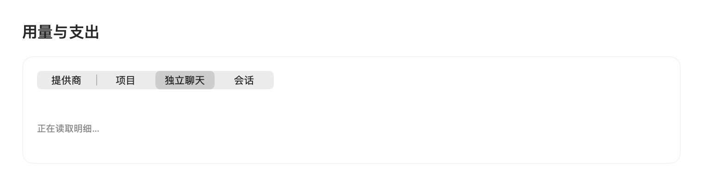
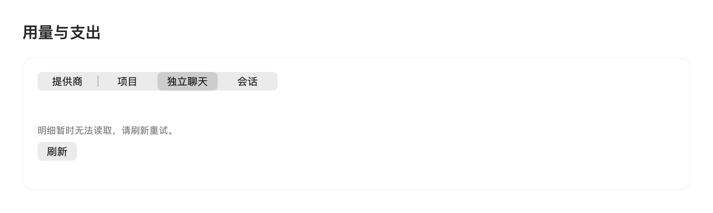
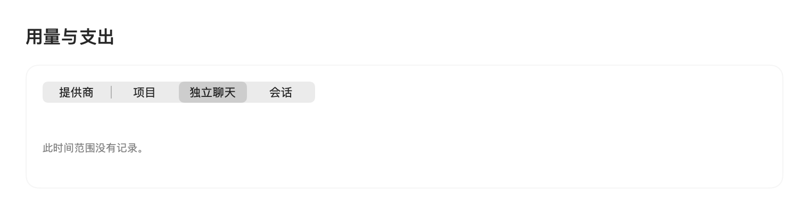
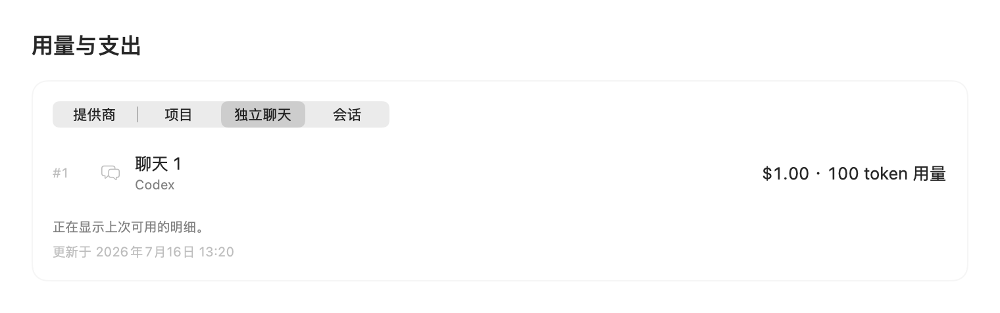

# Synthetic spend detail states

These are SwiftUI component renders from
`SpendDashboardScreenshotRenderTests.test_renderStableDetailStates` with fictional data and
Simplified Chinese localization. Personal information hiding is enabled. PNG EXIF/text metadata
has been removed; pixel data is unchanged.

They demonstrate stable Providers / Projects / Independent Chats / Sessions navigation and
distinct loading, unavailable, complete-empty, and retained-detail messages. They do not prove
live settings-window interaction, account history, or long-term runtime stability. The retained
row's amounts and timestamp are synthetic.

| State | Component render |
| --- | --- |
| Loading |  |
| Unavailable with retry |  |
| Complete empty result |  |
| Retained last complete details |  |

Reproduce on macOS after building the tests:

```sh
CODEXBAR_SPEND_DETAIL_PROOF_DIR=/tmp/codexbar-synthetic-detail-proof \
  make test-fast FILTER=SpendDashboardScreenshotRenderTests.test_renderStableDetailStates
```

The test writes new synthetic renders to the selected directory. Metadata removal is an
additional publication step.
